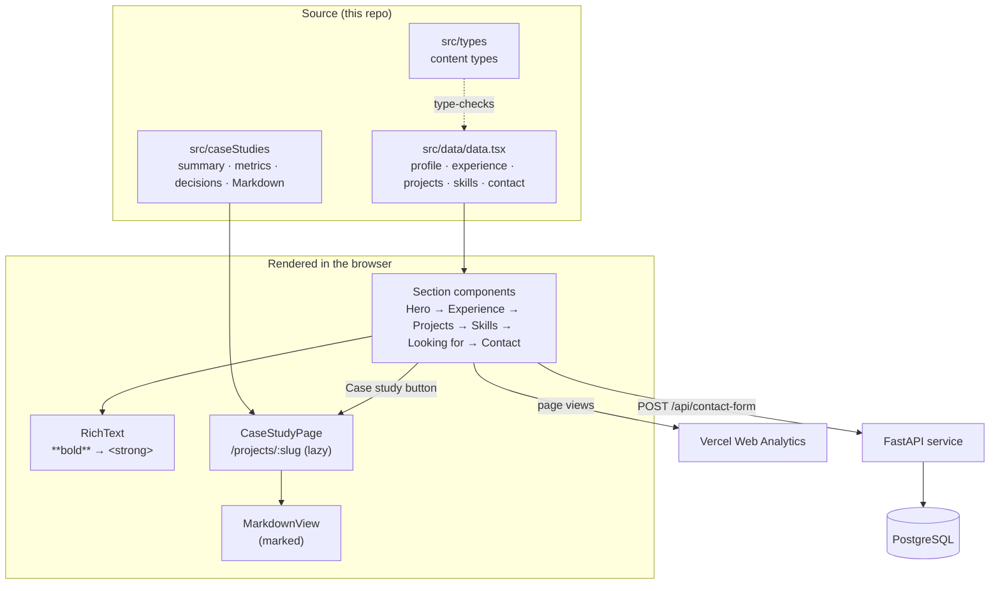
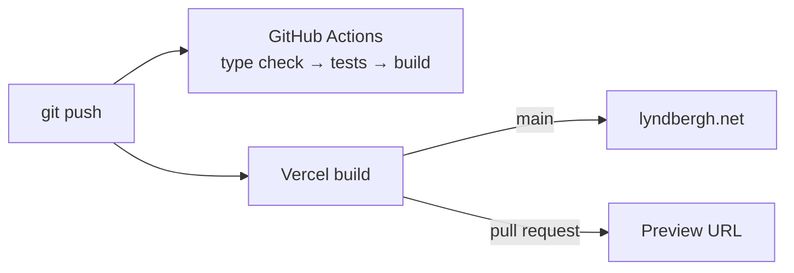

# Lyndbergh Simelus — Portfolio

[](https://github.com/Lsimelus/Portfolio/actions/workflows/ci.yml)

**Live site: [lyndbergh.net](https://www.lyndbergh.net)**

The portfolio of a full-stack software engineer in Boston who builds payments, sign-in and data systems. It's organized the way recruiters read: experience first, then projects, skills, what I'm looking for, and a way to get in touch.

---

## What's on the site

| Section | What it shows |
|---|---|
| **Hero** | Name, role, availability, resume download/view, and six highlight tiles (payments, SSO, business rules + AI, refactoring, legacy rebuilds) |
| **Experience** | Every role with results-first bullets; key phrases in bold for skimming; long roles collapse behind "Show more" |
| **Projects** | Four featured projects with live demos; Real Calc and ABChealth link to case-study pages |
| **Skills** | Grouped by Languages, Frontend, Backend & Data, Security & Auth, Cloud, and Practices & Testing |
| **What I'm looking for** | The role I want next and how to reach me |
| **Contact** | A form that posts to a separate FastAPI service, plus email, GitHub and LinkedIn |

Case studies live at `/projects/:slug` (for example [`/projects/real-calc`](https://www.lyndbergh.net/projects/real-calc)): the problem, key decisions, how it works, and results.

## Tech stack

| Area | Choice |
|---|---|
| UI | React 18, TypeScript, Material UI 5 (Emotion `sx` styling) |
| Routing | React Router 6: `/` and lazy-loaded `/projects/:slug` case studies |
| Content | One typed data file (`src/data/data.tsx`) with lightweight `**bold**` markup |
| Contact form | axios → [FastAPI + PostgreSQL service](https://fastapi-postgres-gamma.vercel.app) (separate repo) |
| Testing | Jest + React Testing Library |
| CI | GitHub Actions: type check, tests and production build on every push and pull request |
| Hosting | Vercel (deploys `main`), with SPA rewrites for deep links |
| Analytics | Vercel Web Analytics (page views, no cookies) |
| SEO | Open Graph / Twitter cards, JSON-LD `Person` schema, canonical URL, `robots.txt` |

**Lighthouse** (production build): accessibility 100, SEO 100, performance 95 mobile / 100 desktop.

## How it's built

Content flows one way, from typed data files to components to the page. The only data that leaves the browser is a contact-form message and anonymous page views.



```
src/
├── App.tsx                  # Page sections in recruiter order + hash scrolling
├── index.tsx                # Router, lazy-loaded case-study route, analytics
├── data/data.tsx            # ALL site content: profile, stats, experience, projects, skills, contact
├── types/index.ts           # Types for that content
├── components/
│   ├── Navbar/              # Desktop links + mobile menu; highlights the section in view
│   ├── HeaderSection/       # Hero, photo (medium screens and up), highlight tiles
│   ├── ResumeSection/       # Experience cards with "Show more", education
│   ├── PortfolioSection/    # Project cards: live demo, case study, code
│   ├── SkillsSection/       # Skills grouped by category, strongest first
│   ├── AboutSection/        # "What I'm looking for"
│   ├── ContactSection/      # Contact form + links
│   ├── CaseStudyPage/       # /projects/:slug
│   ├── RichText/            # Renders **bold** markup from the data file
│   └── SectionHeader/       # Shared eyebrow / title / subtitle
├── caseStudies/             # Case-study pages: one typed list + a Markdown body per project
├── theme/                   # MUI theme (colors, type scale, component defaults)
└── utils/                   # Scrolling and resume download/view helpers
public/
├── Lyndbergh-Simelus-Resume.pdf   # Stable public URL for the resume
├── og-image.png                   # 1200×630 link-preview image
└── index.html                     # Meta tags and JSON-LD
```

Design choices worth noting:

- **Content is data.** Changing a bullet, project or skill means editing `src/data/data.tsx`, not components. Wrap a phrase in `**…**` to bold it.
- **Case studies are data too.** Each one in `src/caseStudies/` has a summary, metrics, key decisions and a short Markdown body: the problem, what I built, the hard parts.
- **Recruiter-first and mobile-first.** Phones get a menu drawer with every section and a resume download, and nothing scrolls sideways at 320px wide.
- **Accessible structure.** Headings follow a strict outline (one `h1`, then `h2` sections), and text colors meet WCAG AA contrast.

## Run it locally

Requires Node 20+.

```bash
npm install
cp .env.example .env    # optional: points the contact form at the FastAPI service
npm start               # http://localhost:3002
```

| Command | What it does |
|---|---|
| `npm start` | Dev server with hot reload |
| `npm test` | Tests in watch mode |
| `CI=true npm test -- --watchAll=false` | Tests once, as CI runs them |
| `npm run build` | Production build into `build/` |

**Environment:** `REACT_APP_API_URL` is the base URL of the contact-form API. It defaults to the deployed FastAPI service.

## Updating the site

| To change… | Edit |
|---|---|
| Hero text, tiles, availability | `profile` in `src/data/data.tsx` |
| Experience, education | `resumeData` in `src/data/data.tsx` |
| Projects | `portfolioData` in `src/data/data.tsx`; add `caseStudySlug` to link a case study |
| A case study | `src/caseStudies/index.ts` (data) and `src/caseStudies/<project>.ts` (Markdown body) |
| Skills | `technologies` in `src/data/data.tsx` |
| Resume PDF | Replace `public/Lyndbergh-Simelus-Resume.pdf` (keep the filename) |
| Link preview | `public/og-image.png` and the meta tags in `public/index.html` |

Project screenshots go in `src/assets/workImages/` as WebP, 1200px wide or less.

## Architecture decisions

Key decisions are written up as Architecture Decision Records in [`docs/`](docs/README.md): why the contact form uses a separate FastAPI service, and how testing, CI and deployment work.

## Deployment




Every push to `main` deploys to production on Vercel. CI runs the same checks on GitHub, and pull requests get Vercel preview deployments. Commit messages follow [Conventional Commits](https://www.conventionalcommits.org/) (`feat:`, `fix:`, `docs:`, `ci:`, `chore:` …).

## Contact

[lyndbergh.net](https://www.lyndbergh.net) · [LinkedIn](https://www.linkedin.com/in/lyndbergh-simelus/) · [GitHub](https://github.com/Lsimelus)
