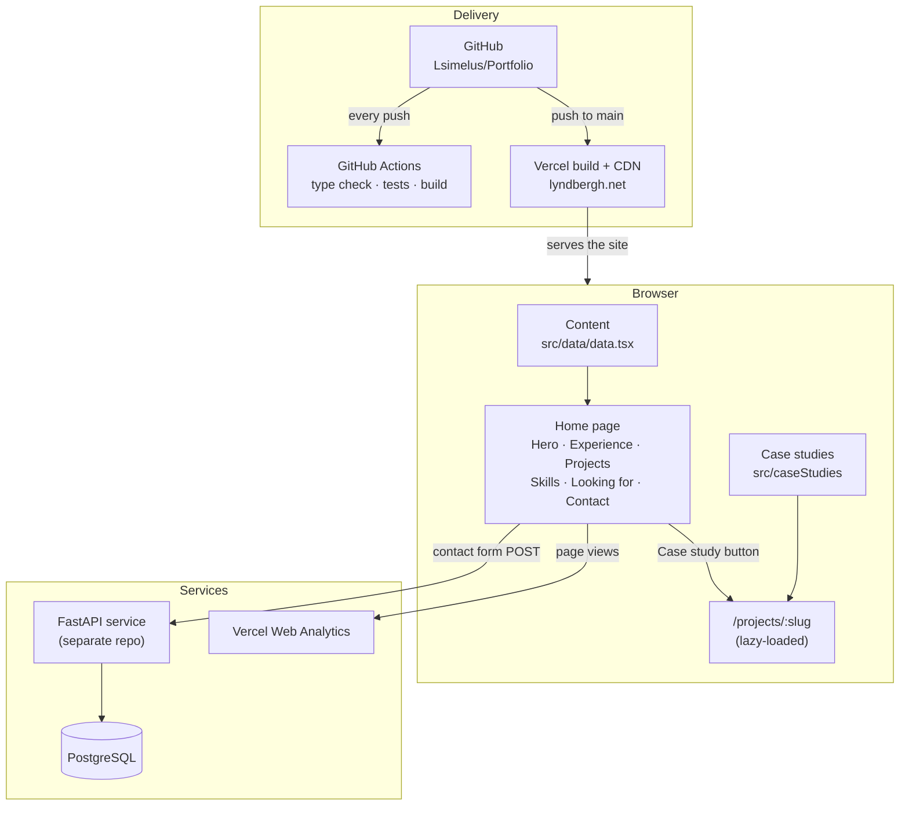

# Architecture decisions

Each record covers one decision for [lyndbergh.net](https://www.lyndbergh.net): the context, what I chose, what I turned down and why, and what it cost.

## The system at a glance

## Records

| # | Decision | In one line |
|---|---|---|
| 1 | [Contact form through a separate FastAPI service](adr/0001-contact-form-through-a-separate-service.md) | Keep the frontend static; own the data; reuse the backend |
| 2 | [Testing, CI and deployment](adr/0002-testing-ci-and-deployment.md) | Behavior tests, CI on every push, Vercel deploys `main` |

## Walking through it in an interview

1. **The system** (diagram above): "The site is a static React app on Vercel. The only data that leaves the browser is a contact-form message and anonymous page views."
2. **The one dynamic piece** (ADR 1): "The contact form talks to a separate FastAPI service, so the frontend stays static and the backend can be reused."
3. **How it ships safely** (ADR 2): "Every push runs type checks, tests and a production build before Vercel serves it."

## Adding a decision

Copy the shape of an existing record: **Status · Date · Context · Decision · Alternatives considered · Consequences**. Number it next in sequence and add it to the table above. When a decision changes, add a new record that supersedes the old one instead of rewriting history.
