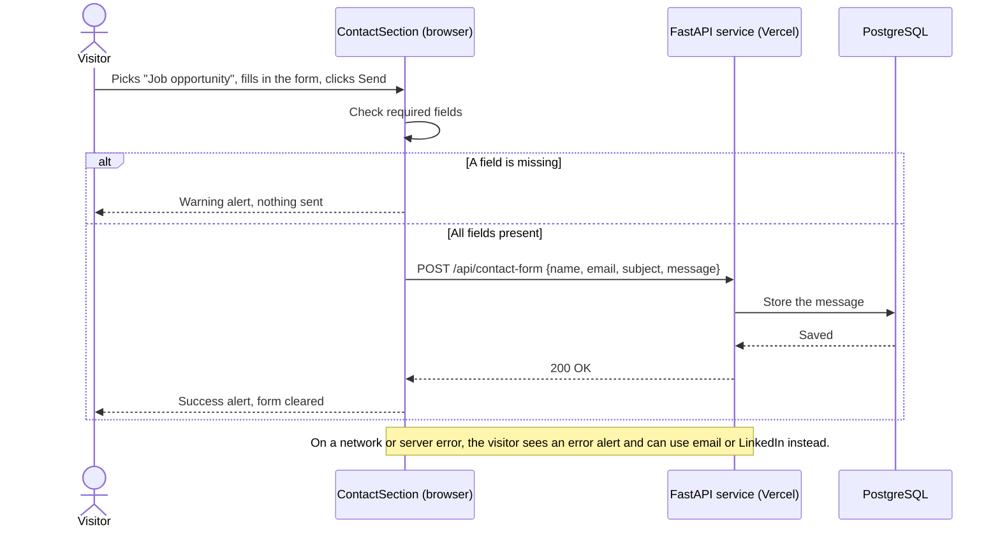

# 1. Contact form through a separate FastAPI service

- **Status:** Accepted
- **Date:** 2023, kept in 2026-11
- **Update (2026-11-18):** The service is now `lyndbergh-platform` (Rails + SQLite); its 39 old messages were imported and the FastAPI service retired. `REACT_APP_API_URL` has no fallback any more, so the production URL stays out of this repo.

## Context

A contact form is the one part of the site that needs a server: it validates input, stores messages and keeps credentials out of the browser. A `mailto:` link alone loses people who don't have a mail client set up.

## Decision

The form posts `{ name, email, subject, message }` to **`/api/contact-form`** on a separate **Python FastAPI** service that stores submissions in **PostgreSQL**. That service is also hosted on Vercel, in its own repository.

- The frontend reads the base URL from **`REACT_APP_API_URL`** and falls back to the deployed service, so local development and tests can point elsewhere.
- Quick-pick chips ("Job opportunity", "Freelance project", "Just saying hi") fill in the subject, so recruiters can send a message in two taps.
- Email and LinkedIn stay visible next to the form for people who prefer them.
- My phone number isn't on the site; email and LinkedIn are enough for first contact.

## Alternatives considered

- **A form service** (Formspree and similar). Less to run, but I'd lose ownership of the data, and it shows less of my backend work.
- **A serverless function inside this repo.** Simpler deploys, but it ties the backend to this frontend. A separate service can be reused by my other projects.

## Consequences

- The portfolio stays a static frontend hosted on Vercel, and the backend can change independently.
- If the service is down, the form fails visibly, and email and LinkedIn still work.
- Tests mock the HTTP call, so they don't depend on the live service.
