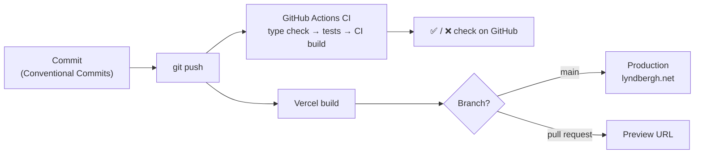

# 2. Testing, CI and deployment

- **Status:** Accepted
- **Date:** 2026-11

## Context

Every push to `main` deploys to production. Before this decision the repo had no tests and no CI, so a typo in the content file or a broken import could take the live site down, and I'd only find out from a visitor.

## Decision

**Tests: Jest and React Testing Library.** Tests check behavior a visitor relies on, not implementation details:

- Every section renders, in the right order.
- Experience shows four bullets, expands with "Show more", and renders `**bold**` markup.
- Each case-study link points to a slug that exists, and case-study pages restore the tab title when you leave.
- The contact form posts the right payload and handles errors (HTTP mocked).
- The mobile menu lists every section and scrolls to the one picked.

Browser APIs that jsdom lacks are mocked once, in `src/setupTests.ts`: `IntersectionObserver`, `scrollIntoView` and `scrollTo`. `marked` ships only as an ES module, which Jest under Create React App can't load, so case-study tests mock the Markdown renderer.

**CI: GitHub Actions** (`.github/workflows/ci.yml`) runs on every push and pull request:

1. Type check (`tsc --noEmit`)
2. Tests
3. Production build with `CI=true`, which also fails the build on lint warnings

**Deployment: Vercel** builds and deploys `main` to production. Pull requests get preview deployments.

**Commits:** [Conventional Commits](https://www.conventionalcommits.org/) (`feat:`, `fix:`, `docs:`, `ci:`, `chore:`), with each batch of work squashed into one commit, so the history reads as a changelog.

## Alternatives considered

- **End-to-end tests (Playwright).** Valuable for multi-page flows. This site is one page plus case studies, so component tests cover it at a fraction of the run time. I use Playwright by hand for mobile and Lighthouse checks.
- **Snapshot tests.** They break on every wording change and don't say what's wrong.

## Consequences

- A broken build or failing test shows a red check on GitHub, and the same checks gate pull requests.
- Vercel deploys independently of CI, so a red check on `main` means fixing forward fast. Using pull requests for larger changes avoids this.
- The CI badge in the README shows the current state.
